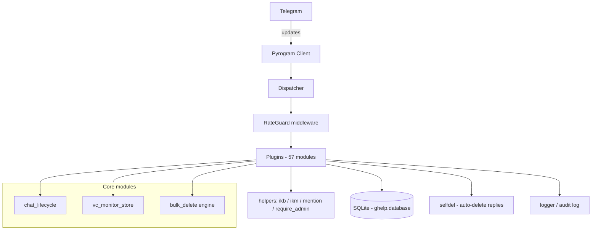
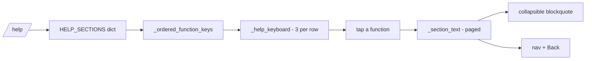
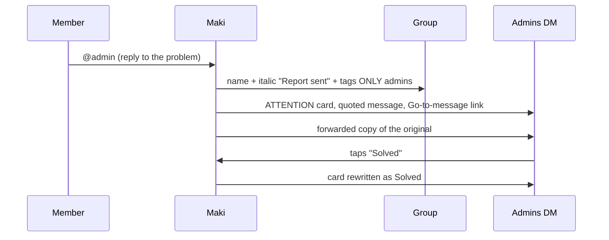
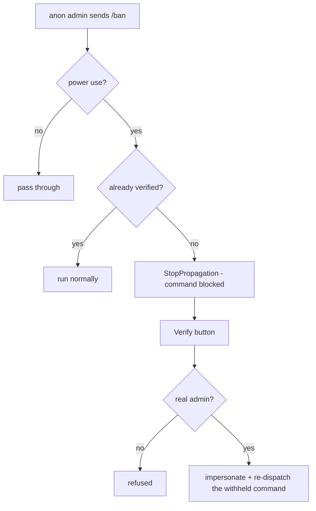

# Architecture

Maki is a **plugin-first** Telegram group-management bot. The core stays tiny;
every feature is a self-registering plugin.

## Runtime shape

## Layering

| Layer | Responsibility | Rule |
|---|---|---|
| `ghelp/__init__.py` | builds the `app` client | no feature logic |
| `ghelp/plugins/*.py` | one feature each | registers its own handlers |
| `ghelp/helpers.py` | shared UI + permission helpers | no feature state |
| `ghelp/database.py` | SQLite access, `DEFAULTS` schema | single source of truth |
| `ghelp/rateguard.py` | per-user flood protection | wraps every handler |

**Why this matters:** a plugin that fails to import cannot take the bot down
with it, and features are added by dropping in a file rather than editing core.

## The help system

- One flat menu, **no nesting** - every function is a button.
- Order is **explicit** (`_ordered_function_keys`), most-used first; anything
  unlisted is appended so a new feature can never vanish.
- Long command lists fold into `<blockquote expandable>`.
- A test crawls all 82 help screens and fails on a dead callback, an
  over-length page, an unbalanced tag, or an emoji left on a button.

## Report flow (`@admin`)

Recipients are **only that group's admins**. The reporter is never notified
back, and the bot owner is not copied into groups they do not administer.

## Verify-before-act (anonymous admins)

An anonymous admin has no `from_user`, so identity is unknown. Maki **holds the
command back** rather than letting it run:

The re-dispatched message is given the verified user's identity so every
decorator (`language`, admin checks, mention rendering) sees a real member.

## Edit Guardian trust

Three roles, deliberately separated:

| Role | May do | Granted by |
|---|---|---|
| **edit-free** member | edits are never deleted | owner or an editor |
| **editor** | run `/editfree` on others | owner or an editor |
| owner | everything, including who may be an editor | Telegram |

`/editfree`, `/editor`. `/trust` and `/exempt` remain as older names.
An exemption is checked **before** the admin test, so it wins even when admin
coverage is enabled.

## Data model

Single SQLite file, one `chats` row per group, with a `DEFAULTS` schema that
migrates forward automatically. Feature settings live as flat keys
(`editguard_on`, `editguard_window`, `editguard_exempt`, ...) so a new setting
never needs a migration.

## Failure philosophy

- A plugin import failure is contained to that plugin.
- Cosmetic failures (a message edit, a `FloodWait` on a panel) must never be
  treated as a feature failure.
- Destructive actions re-read state immediately before acting.
- Every background task is a named `asyncio` task with its own try/except.
