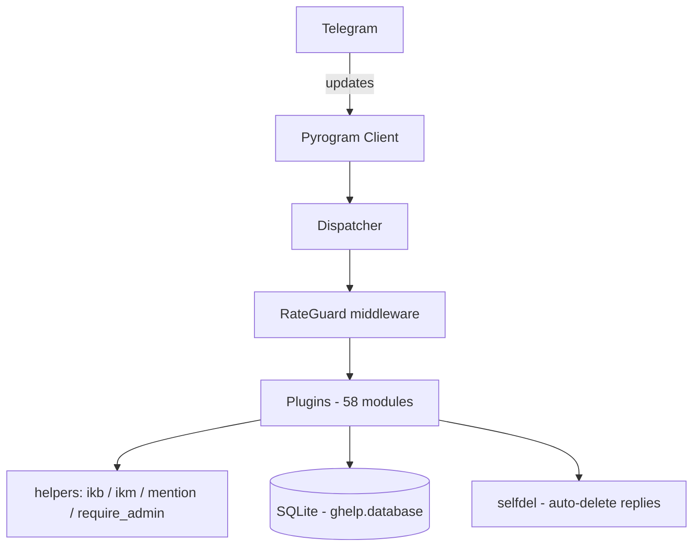

<div align="center">
  
</div>

<div align="center">
  
  <br>
  <sub><i>Real-time moderation · protection · reports — rendered in 3D</i></sub>
</div>


<div align="center">

[](https://github.com/Igoanet/maki-group-bot/stargazers)
[](https://github.com/Igoanet/maki-group-bot/network)
[](https://github.com/Igoanet/maki-group-bot/watchers)
[](https://github.com/Igoanet/maki-group-bot)

[](https://python.org)
[](https://core.telegram.org/bots/api)
[](https://github.com/KurimuzonAkuma/pyrogram)
[](LICENSE)
[](https://github.com/Igoanet/maki-group-bot/commits/main)
[](https://github.com/Igoanet/maki-group-bot)

<br>

**🛡️ The moderation suite that keeps a busy Telegram group readable.**

*300+ commands · 58 plugins · every one documented in the in‑bot help menu*

<br>
</div>

---

<div align="center">

### 📱 What you see when you hit /start


<sub>Clean layout · one idea per line · the admin card appears only for the person who asked</sub>

</div>

---

## ✨ Why this bot

Most group bots dump a wall of commands on you and hope you find one. **Maki is built the other way round.**

| | |
|---|---|
| 🎯 **One flat help menu** | Every function is a button, three per row, ordered by how often an admin actually needs it. No nesting, no dead ends. |
| ✍️ **Messages that respect the chat** | One idea per line, real gaps between blocks, no walls of text. |
| 👻 **Ephemeral replies** | Member-facing cards use Telegram's *ephemeral* messages — visible only to the person who asked. |
| 🔐 **Verify before act** | An anonymous admin's command is **held back** until they prove who they are, then runs with their real rights. |
| 🤝 **Explicit trust** | Edit Guardian exemptions are a named list the group owner controls — and can delegate. |
| 📬 **Reports that land** | `@admin` alerts every admin in the group *and* their DM, with the original message quoted. |

---

## 🚀 Features

<table>
<tr>
<td width="50%" valign="top">

### 🛡️ Moderation
- `ban` / `kick` / `mute` / `tmute`
- `warn` with automatic limits
- `purge` — bulk delete, fast
- `pin` / `unpin` / `pinned`
- `promote` with power tiers
- `restrict` / `approval`

### 🔒 Protection
- Locks for every message type
- Blocklists & blocklist modes
- **Antiflood** with auto‑punish
- **Shield** — AI photo/sticker scan
- **Link Deleter** — kills hidden links
- **Edit Guardian** — stops edit abuse
- CAPTCHA for new members
- Night mode

</td>
<td width="50%" valign="top">

### 👋 Members
- Greetings with media
- Join‑request approval
- **Voice‑chat join notices**
- Tag‑all with a button menu

### 📝 Content
- Notes, rules, filters
- Formatting helpers
- Buttons & fillings
- **Quote stickers** — with SCAM/FAKE badges

### 🧹 Cleanup
- Auto‑delete replies
- Clean commands & service messages

### ⚙️ Owner tools
- Federation bans
- Sudo list · broadcast
- Group console · mass actions

</td>
</tr>
</table>

---

## 🏗️ Architecture

The design is **plugin‑first**: the core stays tiny, every feature is a self‑registering module that cannot take the bot down with it.



**[→ Read the full architecture](ARCHITECTURE.md)** — with diagrams for the report flow, the verify‑before‑act gate, the trust model and the test strategy.

---

## 🚀 Quick start

```bash
git clone https://github.com/Igoanet/maki-group-bot
cd maki-group-bot

python3 -m venv .venv && source .venv/bin/activate
pip install -r requirements.txt

cp .env.example .env      # then fill it in
python3 -m ghelp
```

**Then:** add the bot to a group → promote it to admin with
**Ban users · Delete messages · Pin messages · Change group info · Invite users** → send `/help`.

---

## ⚙️ Configuration

| Variable | Purpose |
|---|---|
| `API_ID` · `API_HASH` | Telegram app credentials — [my.telegram.org](https://my.telegram.org) |
| `BOT_TOKEN` | Token from [@BotFather](https://t.me/BotFather) |
| `OWNER_ID` | Your numeric Telegram id |
| `LOGGER_ID` | Optional log channel |
| `GH_BOT_NAME` | Name shown in the help header |

---

## 🧪 The checks every change must pass

```bash
python3 -m compileall -q ghelp          # syntax
python3 -m pyflakes ghelp | grep -v "unable to detect"   # undefined names
```

Plus a **help crawler** that walks all 80+ help screens and fails on
a dead callback, an over‑length page, an unbalanced tag, or an emoji left on a button.

---

## 🤝 Contributing

Pull requests are welcome. Start with **[CONTRIBUTING.md](CONTRIBUTING.md)** — it covers the plugin layout, house style, and the duplicate‑handler trap that has caused the most real bugs in this codebase.

---

## 🔐 Security

`.env`, `*.session`, cookies and all runtime data are excluded by `.gitignore`.
**A `.session` file grants full account access** — treat it like a password.

See **[SECURITY.md](SECURITY.md)**. Found a vulnerability? Open a private advisory.

---

## 📜 License

MIT — see [LICENSE](LICENSE).

<div align="center">
<br>

**If this bot keeps your group clean, a ⭐ helps others find it.**

<a href="https://github.com/Igoanet/maki-group-bot/stargazers">
  
</a>

<br><br>


</div>
